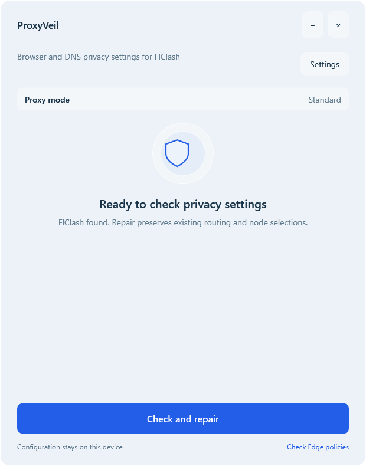
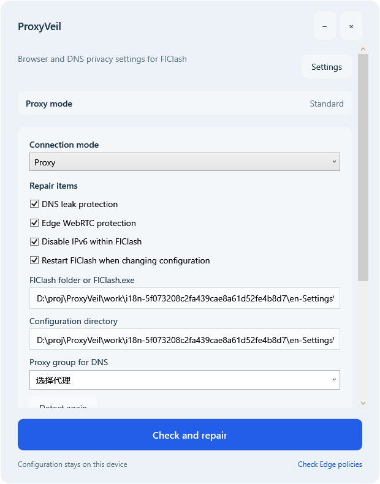
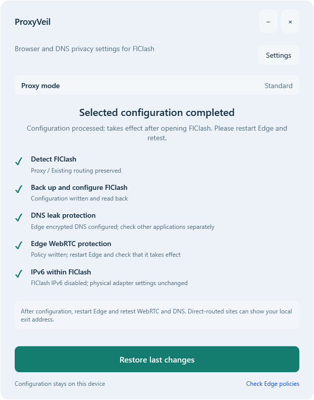

# ProxyVeil

English | [简体中文](README.zh-CN.md)

ProxyVeil configures privacy settings for FlClash. It sets up DNS, Windows Edge WebRTC policies and FlClash IPv6 for TUN or system proxy mode, with snapshots for restoring changes. Existing subscriptions, routing rules and node selections are preserved. FlClash supplies the proxy connection.

Version **0.1.2**. Windows has a PowerShell 7 / WPF interface with Standard and Administrator launchers. macOS has a separate Python CLI.



Screenshots use isolated sample configuration and simulated policies. A completed test flow does not establish that live configuration or network privacy has been verified.

## Start on Windows

You need Windows, PowerShell 7 and FlClash with a working proxy node. Run from source, or fully extract a locally built portable ZIP, keeping its `src`, `scripts` and `docs/images` folders together.

| Entry point | Use |
|---|---|
| `ProxyVeil.cmd` | Double-click to start Standard edition |
| `ProxyVeil.Admin.cmd` | Double-click to start Administrator edition using the current user's UAC |
| `scripts/Launch.ps1` | Launch from PowerShell; supports `-Edition Administrator` |

From the repository or extracted package directory:

```powershell
pwsh -NoProfile -STA -File ./scripts/Launch.ps1
pwsh -NoProfile -STA -File ./scripts/Launch.ps1 -Edition Administrator
```

The launcher searches PATH, PowerShell 7 under Program Files, then the current user's Codex PowerShell runtime. If none is found, it asks you to install PowerShell 7. ZIPs do not bundle a runtime; the console is hidden when the window opens. Administrator edition requires authorization from the same user. Another user's UAC is rejected. Elevation does not take over ACLs or override organization policies.

## Interface language

At startup, Windows selects text from the current user's system display language: Chinese variants use simplified Chinese; all other languages use English. Controls, progress, results and application errors use the same language. Regional date and number formats do not select it. Restart the application after changing the system display language.

The PowerShell launcher also accepts an override; the default is `Auto`:

```powershell
pwsh -NoProfile -STA -File ./scripts/Launch.ps1 -Language en
pwsh -NoProfile -STA -File ./scripts/Launch.ps1 -Language zh-CN
```

Proxy group names, paths and operating system exception details keep their original content. The macOS CLI retains its existing text.

## Use

1. Check that your FlClash subscription works and select a proxy node.
2. Open **Settings** in ProxyVeil and verify the installation and configuration paths. On Windows, the configuration folder must contain `shared_preferences.json`. Enter the paths manually if detection fails.
3. Select TUN or Proxy, choose repair items and select the DNS proxy group. That group should already have a working node selected. ProxyVeil does not determine the node's location.
4. Click **Check and repair**. This saves a snapshot and writes the selected configuration. Opening the window alone does not repair anything.
5. Read the results. FlClash restarts automatically by default, which can briefly interrupt connectivity. To disable automatic restart, quit FlClash first. Restart Edge yourself.



Standard edition requires an already-running FlClashHelperService for TUN. Permission restrictions or conflicting organization policies produce warnings. Administrator edition remains subject to existing access rights and machine policies.

| Item | TUN mode | Proxy mode |
|---|---|---|
| FlClash DNS | Encrypted DNS; disables system DNS append and fallback; configures UDP / TCP port 53 interception | Encrypted DNS; disables system DNS append and fallback |
| Windows Edge DNS | Disables browser DoH so TUN handles DNS | Configures secure DoH and routes specified DoH IPs through the selected group |
| Edge WebRTC | Restricts UDP that bypasses the proxy | Same |
| FlClash IPv6 | Optionally disables FlClash IPv6 and IPv6 DNS resolution | Same |

DNS repair clears `nameserver-policy`, `direct-nameserver`, `fallback` and node-resolution overrides, and configures separate direct encrypted DNS for node bootstrap. Sites depending on internal DNS may stop resolving; restore can recover the original settings. Browser DNS configuration in Proxy mode currently covers Edge. Check other applications' system DNS separately. Disabling FlClash IPv6 does not disable the physical network adapter.



## Restore and verify

When a snapshot exists, the main button becomes **Restore last changes**. It restores FlClash configuration and the Edge policies written by this tool. FlClash handles system proxy settings according to the restored preferences.

Windows snapshots are stored under `%LOCALAPPDATA%\ProxyVeil`. They may contain subscription credentials, with access restricted to the current user, SYSTEM and administrators. Keep the directory until you no longer need to restore. Do not attach raw subscriptions or backups when sharing screenshots, reporting issues or committing code.

Files without additional changes are restored byte for byte. If FlClash only reserializes preferences or updates unrelated fields, restore merges the managed fields while preserving unrelated changes. Conflicts in subscription YAML, managed preferences or policies stop overwrites and keep the snapshot. Check the conflict before retrying.

A check mark means a setting was written and read back. Restart Edge, inspect `edge://policy`, then compare the public exit address, WebRTC addresses and DNS services reported by sites routed through your proxy. Direct-routed domestic sites can show your local exit address. Different addresses alone do not establish a leak. `WebRtcLocalhostIpHandling` requires a browser restart and does not apply to Edge profiles signed in with a Microsoft account; see [Microsoft's policy documentation](https://learn.microsoft.com/en-us/deployedge/microsoft-edge-policies/webrtclocalhostiphandling).

ProxyVeil does not directly change physical adapters, the system firewall or Windows DNS. Supported Windows 11 environments use Desktop Acrylic; otherwise the window uses a translucent background. Confirm the actual blur effect on the desktop.

## macOS entry point

Use the CLI from the source repository on macOS with Python 3 and FlClash. Windows portable packages do not include the Mac files. From the repository directory:

```sh
sh ./scripts/Launch-macOS.sh inspect
# Quit FlClash completely before repair / restore with the native preference layout
sh ./scripts/Launch-macOS.sh repair --mode TUN --items DNS IPv6
sh ./scripts/Launch-macOS.sh restore
```

`inspect` is read-only. `repair` explicitly writes configuration and stores snapshots under `~/Library/Application Support/ProxyVeil` by default. The CLI supports the legacy JSON layout and recognized native preferences with SQLite schema 10 and profile YAML. Unknown structures are rejected. SQLite and generated `config.yaml` are not written. Mac browser DoH / WebRTC are not configured.

Existing Mac host evidence covers FlClash 0.8.99 native-layout repair, readback, restore and application restart. Network acceptance remains limited, including Google HTTPS timeouts. See [macOS usage and parameters](https://github.com/medicagooo/ProxyVeil/blob/main/macos/README.md).

## Develop, test and build

Run these commands from the source repository root. Offline builds generate `dist/ProxyVeil-0.1.2-Standard.zip` and `dist/ProxyVeil-0.1.2-Administrator.zip`. Portable packages contain runtime files, both READMEs and sample images. They omit developer test scripts, subscriptions and snapshots.

```powershell
# Isolated core and UI tests
pwsh -NoProfile -File ./scripts/Test.ps1
pwsh -NoProfile -STA -File ./scripts/Test-UI.ps1
pwsh -NoProfile -File ./scripts/Test-HostReport.ps1
pwsh -NoProfile -STA -File ./scripts/Test-I18n.ps1

# Build runs regression checks; extracted-package tests verify repair and restore
pwsh -NoProfile -File ./scripts/Build.ps1
pwsh -NoProfile -File ./scripts/Test-Package.ps1

# Optional: displayed UI uses fixtures; host inspection reads live configuration
pwsh -NoProfile -STA -File ./scripts/Test-Desktop.ps1
pwsh -NoProfile -File ./scripts/Test-WindowsHost.ps1
```

Configuration tests use isolated directories under `work/` and simulated policies. Native registry tests only write random temporary `HKCU\Software\ProxyVeil.Test-*` keys and clean them up.

Windows 11 has passing PowerShell 7.6.5 and 7.6.6 regression, UI-flow and portable-package records. Displayed window controls and isolated repair / restore have also been verified. Read-only network baselines can reach Baidu and Google. Actual UAC success and DNS / WebRTC / IPv6 leak tests after live Repair / Restore remain untested. This task does not repeat Mac tests or separate Windows 10 acceptance.

- [Windows validation](https://github.com/medicagooo/ProxyVeil/blob/main/docs/validation/windows-012.json)
- [Existing Mac host evidence](https://github.com/medicagooo/ProxyVeil/blob/main/docs/validation/macos-host.json)
- [Project specification](https://github.com/medicagooo/ProxyVeil/blob/main/docs/spec-v1.md)
- [Execution state and remaining work](https://github.com/medicagooo/ProxyVeil/blob/main/STATE.md)
